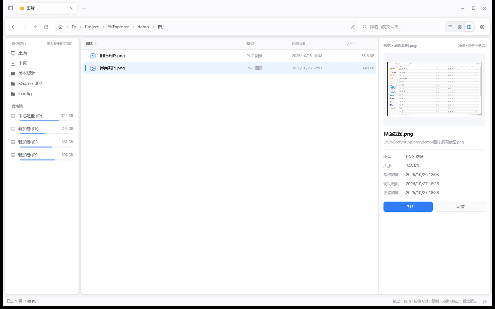
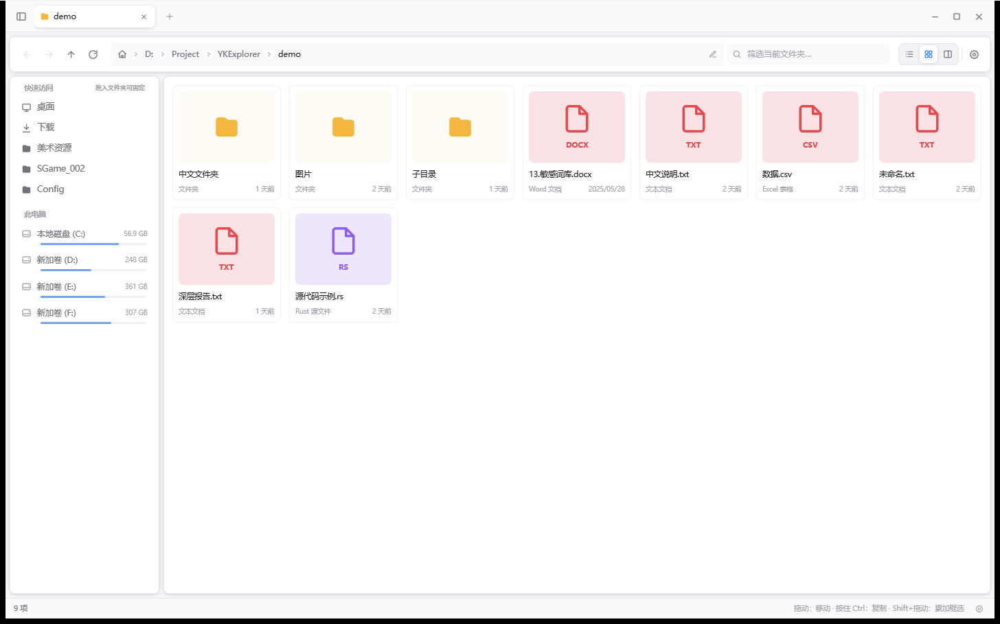
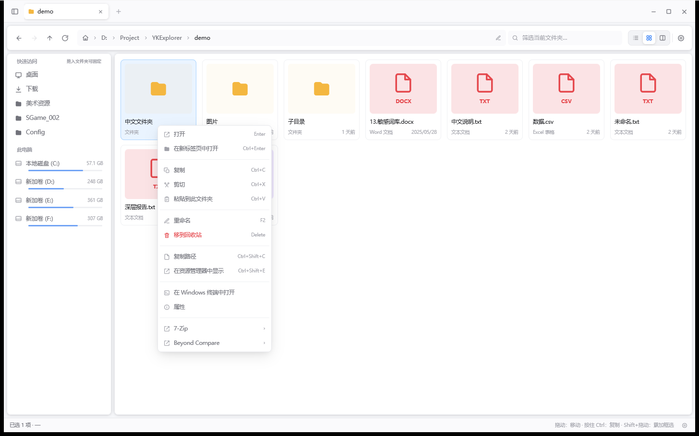
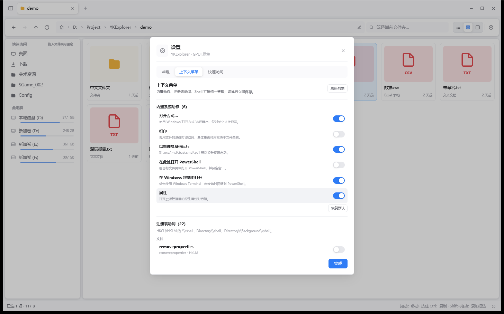
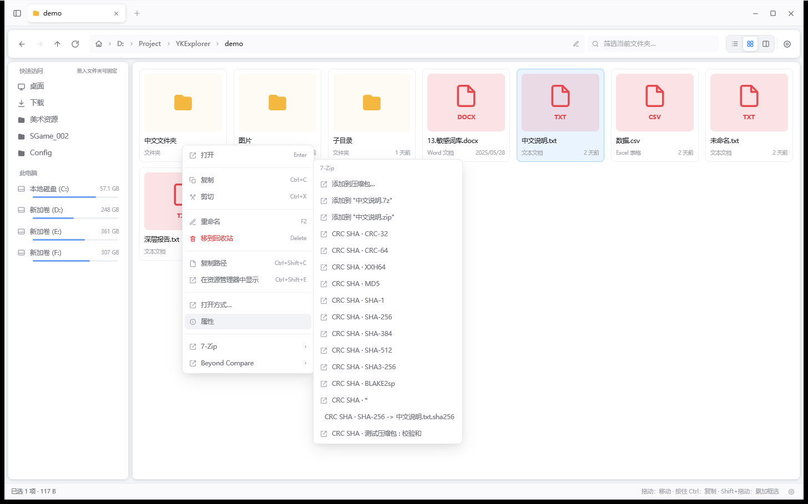
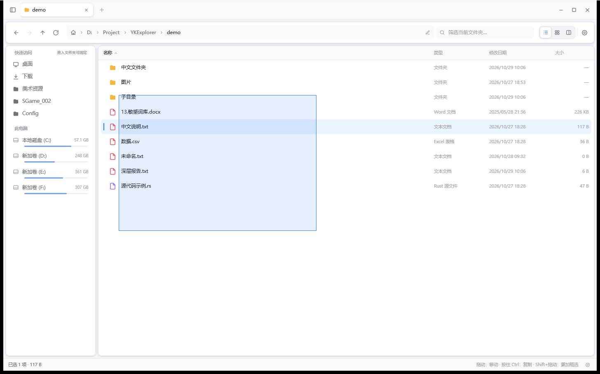
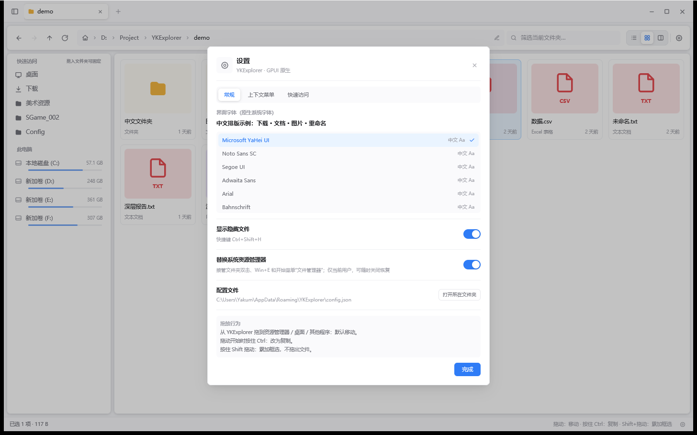
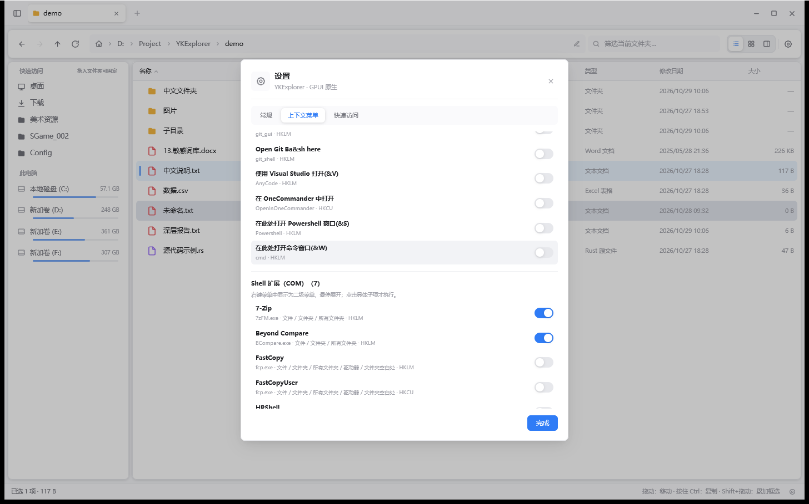
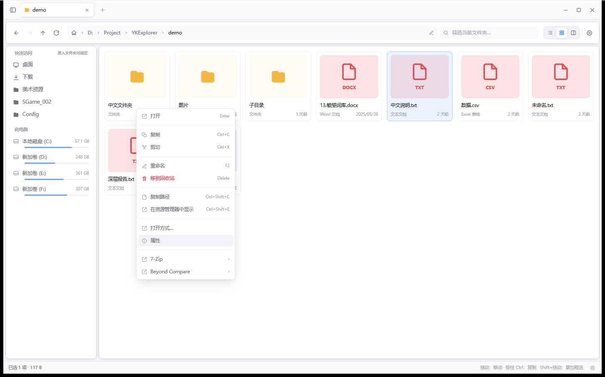

# YKExplorer

一个参考 **File Pilot** 的行为与反编译资料、用 **Rust + GPUI** 重新实现的 Windows 文件资源管理器。  

> 本项目只借鉴交互与信息架构；没有复用 File Pilot 的二进制、私有图标、字体或源码。  
> 与 Voidstar / File Pilot 官方无关。



宫格视图：



系统右键菜单与上下文菜单管理：





注册表右键菜单管理：








Shell 扩展（COM）管理：






## 特性

- **现代资源管理器 UI**：自绘标题栏、标签页、面包屑、快速访问/磁盘侧栏、详情列表、宫格、双栏预览、状态栏。
- **无边框窗口移动**：标题栏空白区整段可拖动；用后台光标跟随线程 + `SetWindowPos` 移动窗口，不依赖 GPUI 未实现的 `start_window_move`，也不进入会重入 GPUI 的原生消息循环。
- **原生中文字体**：启动时自动从系统字体中选择微软雅黑/Noto/思源/黑体/宋体等可用中文字体，并显式设置 CJK 回退链；界面、文件名、路径、按钮全中文。
- **中文输入**：单行编辑器完整实现 GPUI `EntityInputHandler`，支持 IME 组合输入、选区、剪贴板、光标；并主动把 Windows IME 候选窗锚定到光标位置。
- **原生文件拖出**：优先使用 Windows Shell 数据对象（`IShellItemArray`/`BHID_DataObject`，Explorer 原生格式），失败时回退自研 `CF_HDROP`；配合自定义 `IDropSource` + `DoDragDrop` 拖到资源管理器、桌面、聊天软件等。
  - **默认允许移动|复制**，目标根据位置/修饰键选择
  - **拖动开始时按住 Ctrl**：改为复制（Shift 留给框选）
  - 使用真实鼠标按键/光标轮询触发拖拽，快速移出窗口时不会漏掉拖拽开始
- `DoDragDrop` 通过窗口子类在 **UI 线程** 执行，拖放期间保留源窗口鼠标捕获；私有 `WM_APP` 消息保证进入拖放时 GPUI 借用已释放
- 本地 patch 了 gpui 的 `DragEnter`：原实现把 `HGLOBAL` 二次解引用后传给 `DragQueryFileW`，拖回自身窗口会崩在 `windows.storage.dll`
- **外部文件拖入**：接收来自资源管理器的 `CF_HDROP`；拖入文件列表内容区会复制到当前文件夹；也可直接拖到侧栏驱动器或快速访问位置（例如拖到 `F:` 会复制到 F 盘根目录）。
  - **支持从压缩软件（7-Zip / WinRAR 等）拖出**：这类程序在拖动过程中只提供自己的临时解压目录（`%TEMP%\7zE…`），鼠标松开后才解压并给出真实文件，`Drop` 一返回就删除临时目录。因此在 `Drop` 时重新读取 `CF_HDROP`，并在返回前把解压结果 rename 进本程序自己的暂存目录（同盘 rename，瞬时完成），随后照常异步复制——不会再只留下一个空的 `7zE…` 文件夹；真正耗时的解压与复制分别由压缩软件和后台任务完成。
- **系统右键菜单子集**：在 YKExplorer 右键菜单中接入 Windows Shell 动词——打开方式、打印、以管理员身份运行、在此处打开 PowerShell、在 Windows 终端中打开、属性。
- **注册表右键菜单管理**：枚举 `HKCU/HKLM\Software\Classes\*\shell`、`Directory\shell`、`Directory\Background\shell` 中已注册的动词（Git、VS Code、PowerShell 等），在 **设置 → 上下文菜单** 中逐项启用；启用项按文件/文件夹/空白处作用域出现在 YKExplorer 右键菜单，通过 `ShellExecuteExW` 调用。
- **Shell 扩展（COM）**：枚举 `shellex\ContextMenuHandlers`（`*`、`Directory`、`Folder`、`Drive`、`Directory\Background`，HKLM/HKCU 及 Wow6432Node），显示名优先取扩展 DLL 的产品名——例如 **7-Zip**、**Beyond Compare**（注册名实际是 `CirrusShellEx`）。每个扩展在右键菜单中是一个**二级菜单**：鼠标悬停扩展名即展开，点击一级项不执行任何动作；子项由扩展的 `IContextMenu` 预构建（7-Zip 的“添加到压缩包 / CRC SHA”等会分别列出），点击具体子项才直接 `InvokeCommand`，不弹出额外的原生菜单。
- **框选**：在文件列表空白处按住左键拖动即可框选；**按住 Shift 在文件上拖动**同样强制框选，并**累加到已有选择**（例如已选 4、5，再用 Shift 从 1 拖到 2，结果为 1、2、4、5），不会把文件拖出去。拖动时鼠标经过的行/卡片会加入选择，松手结束。
- **替换系统资源管理器**：设置 → 常规中开启后，写入 `HKCU\Software\Classes\Folder|Directory|Drive\shell\open\command` 与对应的 `shell\explore\command`（`explore` 是独立的"新窗口打开"动词，部分启动器会用），并接管 `CLSID\{52205fd8-5dfb-447d-801a-d0b52f2e83e1}`（显示名就是“File Explorer”）的 `opennewwindow`，因此文件夹双击、**Win+E** 和开始菜单“文件管理器”都会打开 YKExplorer。写入前备份原命令、值类型和 DelegateExecute，关闭时完整恢复；用无效的 `DelegateExecute` 覆盖 HKLM 委托，让 Shell 回退到 YKExplorer 命令。
- **独立配置文件**：所有设置保存在 `%APPDATA%\YKExplorer\config.json`，与安装目录完全分离——覆盖安装 / 换目录 / 删掉程序都不会重置配置。旧版本写在 `settings.json` 或程序目录 `ykexplorer.settings.json` 的配置会在首次启动时自动迁移，并把旧文件改名为 `*.json.migrated` 留作备份。设置 → 常规 里显示该路径并提供「打开所在文件夹」。
- **文件操作**：打开、复制、剪切、粘贴、重命名、新建文件夹/文件、回收站删除、永久删除（确认）、复制路径、在资源管理器中定位。新建入口不只在列表空白处：右键任意文件/文件夹同样有「新建文件夹」「新建文件」，另可用 `Ctrl+Shift+N` / `Ctrl+Alt+N`（列表排满时也能新建）。
- **可编辑快速访问**：侧栏「快速访问」支持把条目拖动——按住后出现一个**跟随光标的悬浮卡片**（图标 + 名称 + 状态提示）；放回原来那一行即取消，松开在任何其它位置（包括窗口外）即移除。把文件夹拖进侧栏则固定到快速访问；列表持久化到设置文件。设置 → 快速访问页可开关内置默认项，并提供「恢复默认」。
- **悬停跟随动画**：鼠标在**文件列表、宫格、左侧快捷栏/驱动器**之间移动时，深色高亮（`#E4E7EF`）会像**从 UI 后方浮起**——从中心略内缩、近乎透明，用 200ms `ease-out-quint` 放大并上浮到整块，离开时反向缩回。高亮是绝对定位层（始终存在、仅切透明度），既不挤动文件名位置，也不会让 hover 事件抖动；文件列表已去掉行分隔线，选中态同样是圆角色块，与侧栏风格统一。
- **打开文件动画**：双击或回车打开文件时，底部弹出「文件名 + 正在打开…」圆角提示，160ms 淡入并上移，620ms 后自动消失。
- **递归搜索**：在搜索框中输入并在按 **Enter** 后，会递归搜索当前文件夹及所有子文件夹（最多 5000 条），结果列表的“类型”列显示相对路径；按 **Esc** 或点清除按钮回到普通列表，打开结果后自动退出搜索。
- **撤销**：**Ctrl+Z** 或右键菜单“撤销”可逐步回退重命名、新建文件夹/文件、复制、移动、移到回收站（从回收站还原），最多保留 64 步。
- **浏览体验**：多标签、前进/后退/上级、历史、即时筛选（支持 `*` `?` 通配）、按名称/类型/日期/大小排序、文件夹优先、自然数字排序、多选。
- **大目录渲染**：`uniform_list` 虚拟滚动；目录扫描与文件操作在 GPUI background executor 中执行。
- **系统图标位/缩略图**：文件夹与文件类型用内嵌 SVG；本地图片文件在宫格和预览栏中真实显示。

## 图标

程序图标由 `assets/icons/explorer.svg`（矢量绘制：蓝色圆角方块 + 白色文件夹 + 列表行）生成。构建时 `build.rs` 会：

1. 用 `resvg` 把 SVG 光栅化成 16/24/32/48/64/128/256 七个尺寸；
2. 打包成 `.ico`；
3. 调用 Windows SDK 的 `rc.exe` 编译资源并链接进 exe。

因此改图标只需改那个 SVG，重新构建即可；找不到 `rc.exe` 时会跳过并给出 warning，不影响编译。

## 构建

需求：

- Windows 10/11 x64
- Rust stable（本项目使用 `rustc 1.94.0`）
- Visual Studio 2022 C++ Build Tools（MSVC + Windows SDK）
- 支持 D3D11 的显卡

```powershell
cd YKExplorer
cargo build --release
```

> 源码包含 `vendor/gpui`（修复了 `DragEnter` 的 `HDROP` 传递），`Cargo.toml` 通过
> `[patch.crates-io]` 指向它；构建时不要删除该目录。

也可以用：

```powershell
.\build.ps1
```

生成：

```text
target\release\YKExplorer.exe
dist\YKExplorer.exe        # build.ps1 会复制一份带品牌名的可执行文件
```

直接在资源管理器中双击 `dist\YKExplorer.exe` 即可。也可以用参数指定初始目录：

```powershell
.\dist\YKExplorer.exe "D:\Project\YKExplorer\demo"
```

> **构建注意**：本机 Microsoft Visual Studio 14.44 的 MSVC 在编译 `ring` 的 `/Z7` 调试记录时会报 `D8050`。
> 工程因此在 `Cargo.toml` 里设置了 `debug = 0`；如需调试符号，可自行调整 profile，或使用完整 `vcvars64.bat` 环境。

## 快捷键

| 快捷键 | 功能 |
|---|---|
| `Alt+←` / `Alt+→` / `Alt+↑` / `Backspace` | 后退 / 前进 / 上一级 |
| `Ctrl+L` | 编辑地址栏 |
| `Ctrl+F` | 聚焦筛选框 |
| `Ctrl+T` / `Ctrl+W` / `Ctrl+Tab` / `Ctrl+Shift+Tab` | 新建标签 / 关闭标签 / 下个标签 / 上个标签 |
| `Enter` / `Ctrl+Enter` | 打开 / 在标签页中打开文件夹 |
| `Ctrl+C` / `Ctrl+X` / `Ctrl+V` | 复制 / 剪切 / 粘贴文件 |
| `Delete` / `Shift+Delete` | 移到回收站 / 永久删除（确认） |
| `F2` | 重命名 |
| `Ctrl+Shift+N` / `Ctrl+Alt+N` | 新建文件夹 / 新建文件 |
| `Ctrl+A` | 全选 |
| `↑` / `↓` / `Shift+↑` / `Shift+↓` / `Home` / `End` | 选择与扩展选择 |
| `Ctrl+1` / `Ctrl+2` / `Ctrl+3` | 详情 / 宫格 / 双栏 |
| `Ctrl+B` | 显示/隐藏侧栏 |
| `Ctrl+Shift+H` | 显示/隐藏隐藏文件 |
| `Ctrl+Shift+C` | 复制所选路径 |
| `Ctrl+Shift+E` | 在资源管理器中显示 |
| `F5` / `Ctrl+R` | 刷新 |
| `Esc` | 关闭编辑器/菜单/弹窗，或取消选择 |

## 使用系统右键菜单

右键单个文件、文件夹或列表空白处，会出现对应系统动作。可在 **设置 → 上下文菜单** 中逐项启用/禁用，切换后立即生效并自动保存。

> 这些动作由 Windows Shell 执行；可用性取决于文件类型、文件关联和系统策略。YKExplorer 只负责发起系统动词，不复制 Explorer 的完整原生菜单。

### 注册表右键菜单

**设置 → 上下文菜单** 用一个可滚动列表统一管理三类菜单：

1. **内置系统动作**：打开方式、打印、管理员运行、PowerShell、Windows Terminal、属性。
2. **注册表动词**：读取 `HKCU/HKLM\Software\Classes\*\shell`、`Directory\shell`、`Directory\Background\shell` 的注册项，显示标题、动词名与来源 hive；启用后通过 `ShellExecuteExW` 执行。
3. **Shell 扩展（COM）**：读取 `*`、`Directory`、`Folder`、`Drive`、`Directory\Background` 下的 `shellex\ContextMenuHandlers`。7-Zip、Beyond Compare、火绒等都属于这种方式；显示名优先取扩展 DLL 的产品名，所以 Beyond Compare 不会显示成 `CirrusShellEx`。

- 只读取注册表，不会修改系统设置；
- COM 注册项只保存 DLL 与显示名，没有命令行；YKExplorer 在打开右键菜单时实例化该扩展的 `IContextMenu`，把它的功能项预构建到二级菜单里；
- 鼠标悬停一级项展开二级菜单，点击一级项不执行动作也不关闭菜单；点击二级项时直接 `InvokeCommand`；
- 7-Zip 的“添加到压缩包 / 添加到 .7z / 添加到 .zip / CRC SHA …”会作为独立子项列出，不再合并成一个“打开程序”；
- 系统自带的 `shellex`（共享、打开方式等）会被过滤，只保留第三方扩展；
- 条目较多时列表可滚动，右键菜单建议只开启常用项；
- 使用 `DelegateExecute` 的现代动词可能无法由 `ShellExecuteExW` 直接调用，会显示失败提示。

## 拖拽文件到其他程序

1. 在详情行或宫格卡片上按住鼠标左键拖动，移动超过 4px 后进入原生 OLE 拖放。
2. **不按修饰键**：允许 `DROPEFFECT_MOVE | DROPEFFECT_COPY`，最终动作由目标决定；资源管理器/桌面通常会按盘符与修饰键选择。
3. **在拖动一开始就按住 Shift**：只允许 `DROPEFFECT_COPY`，目标表现为复制。
4. 拖放完成后回到 YKExplorer 会自动刷新当前目录。
5. 如果在 YKExplorer 内部把文件拖到左侧 **F:** 等驱动器行或快速访问位置，会复制到对应目标目录。

> 说明：拖放的最终动作由接收目标决定（这是 Windows Shell 的协议设计）。当前跨进程拖拽使用标准 Shell
> `IDataObject`；它的跨进程兼容性优先于自定义 Preferred DropEffect。只接受“复制”的聊天/浏览器类程序会按其自身
> 支持的操作接收文件。

**建议手工验收**：

```text
1. 打开 YKExplorer 到 demo 目录，另开资源管理器到目标目录。
2. 把 “中文说明.txt” 拖到资源管理器：源文件应消失（移动）。
3. 重新创建该文件；按住 Shift 再拖一次：源文件应保留（复制）。
```

## 架构

```
src/
├─ app.rs          状态、动作、导航、选区、拖放接线、全部界面
├─ fs.rs           目录枚举、文件元数据、磁盘/用户目录、排序/筛选/格式化
├─ ops.rs          复制/移动/新建/重命名/回收站/永久删除/Shell 打开
├─ clipboard.rs    CF_HDROP + CFSTR_PREFERREDDROPEFFECT 读写
├─ drag_out.rs     原生 OLE IDataObject/IDropSource/DoDragDrop
├─ drag_host.rs    窗口子类：在 UI 线程执行 DoDragDrop
├─ text_input.rs   GPUI 单行编辑器（IME / 选区 / 剪贴板 / 候选窗定位）
├─ theme.rs        颜色、字体回退链、尺寸
├─ assets.rs       内嵌 SVG 图标
├─ debug_ipc.rs    仅 debug 构建的本地调试命令通道（可选启用）
└─ main.rs         窗口创建、快捷键绑定
```

更多设计与 API 调研见：

- [`docs/DESIGN.md`](docs/DESIGN.md)
- [`docs/PLAN.md`](docs/PLAN.md)
- [`docs/VERIFICATION.md`](docs/VERIFICATION.md)
- [`docs/DEBUG_IPC.md`](docs/DEBUG_IPC.md)

## 已知限制

- 不支持文件系统实时监听（`ReadDirectoryChangesW`/`notify`），外部变更需按 `F5` 刷新。
- 拖出时未提供自定义拖影缩略图，使用系统默认拖放光标；文件数据本身完整。
- 图片缩略图仅覆盖 GPUI 自带解码格式（PNG/JPG/GIF/WebP/BMP/ICO 等），不生成通用缩略图缓存。
- 文件操作显示汇总结果而非逐字节进度条。
- 没有管理员提权、网络凭据、搜索索引、压缩包内浏览等高级功能。
- 暂未持久化窗口大小/位置。
- 注册表右键菜单同时覆盖 `shell` 动词与 `shellex\ContextMenuHandlers` COM 扩展；COM 扩展的二级菜单由扩展自身生成，YKExplorer 只保留两层，更深的子菜单（如 7-Zip 的 CRC SHA 内部）会被拍平到第二层。
- 使用 `DelegateExecute` 的动词可能无法通过 `ShellExecuteExW` 调用；仅 32 位的 COM 扩展在 64 位进程中不会列出；无法成功创建菜单的扩展会被跳过。
- 若复制到受保护目录或外接盘时系统返回“拒绝访问”，请先检查目标 ACL；Windows Explorer 在同类目录会弹出提权/继续提示，YKExplorer 目前只显示错误，不会自动提权重试。
- 调试实例若受外层文件沙箱限制，也可能出现跨盘写入错误。
- 从被打上 **Low 完整性** 标签的目录/沙箱启动时，Windows UIPI 会阻止向 Explorer 等 Medium 进程拖放（目标直接显示禁止光标且不查询数据对象）。请从普通目录启动 YKExplorer。

## 测试

```powershell
cargo test
```

当前自动测试 **19 passed / 1 ignored**。覆盖：

- 文件大小/日期格式化、通配符筛选、目录优先排序、隐藏项过滤
- 复制/移动、冲突自动改名、Windows 非法文件名
- CF_HDROP/UTF-16 路径与 Preferred DropEffect 序列化、自定义 IDataObject COM 读取、IDataObject 跨进程编组
- 设置项默认值/JSON 往返、Shell 菜单开关、注册表菜单启用项持久化、可执行文件判定
- 注册表菜单作用域路径/稳定 ID、枚举不 panic
- 剪贴板往返测试因 Windows 剪贴板需要交互式桌面，默认标记 `ignored`：
  ```powershell
  cargo test clipboard::tests::file_list_round_trips_through_clipboard -- --ignored
  ```

## 调试接口（仅 debug）

不移动鼠标、不抢焦点也能检查和操作应用：用 `--debug-port=47654` 启动 debug 构建，通过 `127.0.0.1:47654` 的单行命令通道控制。

```powershell
$env:RUST_LOG='YKExplorer=info'
cargo run -- --debug-port=47654 "D:\Project\YKExplorer\demo"

# 另开一个终端
. .\tools\debug_ipc.ps1
Invoke-YKExplorerDebug 'state'
Invoke-YKExplorerDebug 'settings context'
Invoke-YKExplorerDebug 'navigate F:\'
Invoke-YKExplorerDebug 'copy-test D:\Project\YKExplorer\demo\中文说明.txt|F:\'
```

完整命令见 [`docs/DEBUG_IPC.md`](docs/DEBUG_IPC.md)。调试通道只在 `debug_assertions` 构建中出现，release 不编译、不监听端口。

未处理 panic / 异常会追加写入 `%LOCALAPPDATA%\YKExplorer\crash.log`；若该目录不可写则回退到 exe 同目录 `ykexplorer-crash.log`。

## 许可

MIT。详见 [`LICENSE`](LICENSE)。

内嵌 SVG 图标为本项目自制；没有使用 File Pilot 的资源。
